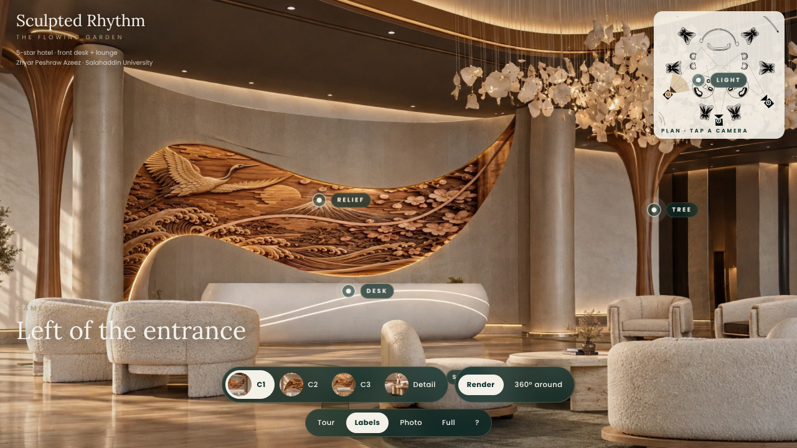
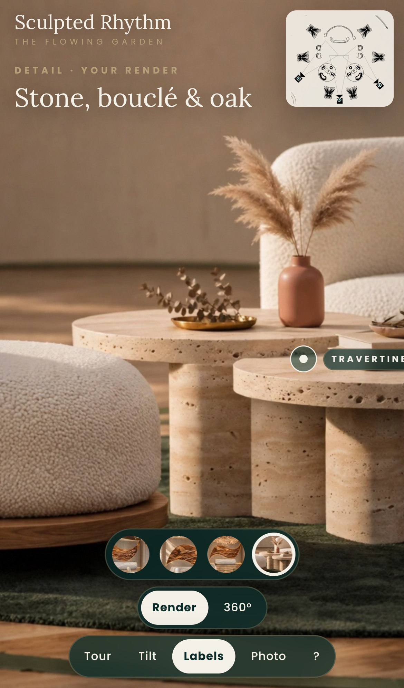
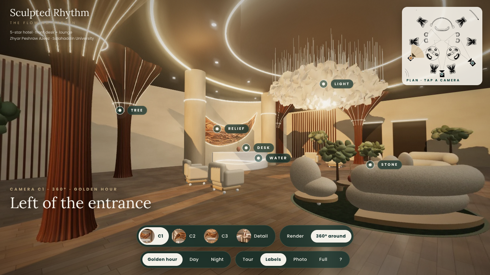

# Sculpted Rhythm — The Flowing Garden
**Inside the reception · interactive 3D viewer**

A 5-star hotel front desk and lounge built on three ideas — **Tree**, **Water** and **Stone** — and the motto *Growth. Flow. Gathering.*

**Author:** Zhyar Peshraw Azeez · Department of Architecture, Salahaddin University

| Desktop | Phone |
|---|---|
|  |  |



## What it does
- **Render mode (default)** – the project's own renders (cameras **C1, C2, C3** and a stone **Detail** shot) with an estimated depth map. Move the mouse (or tilt your phone) and the room shifts in 3D, as if you were leaning inside the reception.
- **360° mode** – stand at each camera point and look in every direction (built from the 3D model), in *Golden hour / Day / Night* light.
- Labelled hotspots (Tree · Water · Stone · Relief · Light · Desk) with concept notes, plan mini-map, tour mode, photo export.
- Built for phones: touch pan / pinch-zoom, tilt-to-look, safe-area aware layout, lighter 360° images on mobile, and a simple fallback if the device has no WebGL 2.

## Publish it (GitHub Pages) — 2 minutes
This repository has only about 40 files, so it fits in a single GitHub upload (the web uploader accepts fewer than 100 files at a time).

1. Create a new **public** repository on GitHub.
2. Click **Add file → Upload files** and drag in **everything inside this folder** (the files and folders, not the zip itself). `index.html` must be at the top level of the repository.
3. **Settings → Pages → Build and deployment → Deploy from a branch → `main` / `/ (root)` → Save.**
4. After 1–2 minutes the viewer is live at `https://<your-username>.github.io/<repo-name>/`. Open that link on your phone.

> Opening `index.html` from the GitHub *code* page, or from a zip preview, will not work — use the Pages link, or the offline version below.

## Run it offline
Unzip / download the repository and double-click **`offline/index.html`** (everything is embedded in that single file). Opening the main `index.html` from your computer also redirects to it automatically.

## Controls
| | Desktop | Phone |
|---|---|---|
| Look into the render | move the mouse | tilt (tap **Tilt**) or drag |
| Pan / zoom | drag · scroll | drag · pinch |
| Change view | C1 · C2 · C3 · Detail, or click a camera on the plan | tap a thumbnail |
| 360° | **360° around** | **360°** |
| Tour | **Tour** (or `T`) | **Tour** |
| Keys | `1–4` view · `L` labels · `P` photo · `F` fullscreen · `H` help | |

Works in current Chrome, Edge, Firefox and Safari (iOS 15+).

## Troubleshooting
- **Blank or "Could not load the images"** – you opened the file from a zip or a code view. Use the Pages link or `offline/index.html`.
- **Slow on an old phone** – turn off *Labels*, or use *Render* mode instead of 360°.
- **"Graphics were reset"** – the phone ran out of memory; tap *Reload*.
- **Tilt button does nothing on iPhone** – tap it once and allow *Motion & Orientation* access when asked.

## Repository contents
```
index.html            viewer for GitHub Pages (loads images from /assets)
offline/index.html    the same viewer as one self-contained file
assets/photos/        the renders and their depth maps
assets/pano/          360° views (one file per camera and light; 1536 px and 1024 px for phones)
board/                the presentation board (PDF)
previews/             screenshots
source/               viewer source (template.html, viewer.js)
```

## Notes
Depth for the renders is estimated from the flat images, so movement is kept gentle. The 360° views are generated from the author's 3D model of the same design.

© Zhyar Peshraw Azeez — see `LICENSE.txt`.
